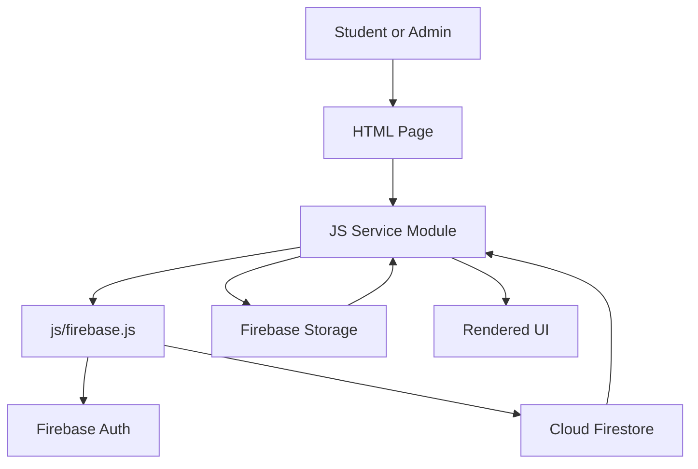

# StudentHub Architecture

StudentHub is currently a static frontend application backed by Firebase services.

## Runtime Model

- HTML files define the page shells.
- CSS is split into base, component, and page styles.
- JavaScript modules provide page behavior and Firebase workflows.
- Firebase Authentication manages signed-in users.
- Cloud Firestore stores users, resources, transactions, libraries, activities, notifications, and platform metrics.
- Firebase Storage stores uploaded resource files.

## Directory Responsibilities

| Path | Responsibility |
| --- | --- |
| `Admin/` | Admin-only HTML surfaces. |
| `assets/` | Static images, favicons, and logos. |
| `css/base/` | Reset and theme variables. |
| `css/components/` | Reusable component styles. |
| `css/pages/` | Page-specific styles. |
| `docs/` | Project documentation. |
| `js/firebase.js` | Firebase app initialization and shared service exports. |
| `js/service/` | Feature services and page controllers. |
| `js/utils/` | Shared constants, formatting, and DOM helpers. |
| `pages/` | Authenticated student-facing pages. |

## Frontend Flow

1. A page loads its HTML and CSS.
2. The page imports one or more JavaScript service modules.
3. `js/firebase.js` initializes Firebase once and exports shared `app`, `auth`, and `db` instances.
4. Auth-aware services use `onAuthStateChanged()` to protect routes and load user data.
5. Feature services query or update Firestore and render results into the page.

## Main Services

| Module | Purpose |
| --- | --- |
| `auth.js` | Registration, login, route protection, profile rendering, and admin checks. |
| `dashboard.js` | Dashboard profile, stats, notifications, recent activity, and chart rendering. |
| `resources.js` | Resource upload, detail page, and admin review queue. |
| `marketplace.js` | Marketplace listing, filtering, sorting, and resource modal. |
| `marketplace-actions.js` | Download/purchase transaction bookkeeping. |
| `library.js` | User library writes and library page rendering. |
| `activity.js` | Activity creation and recent activity reads. |
| `notifications.js` | Notification creation, retrieval, and read status updates. |
| `admin.js` | Admin financial metrics. |
| `analytics.js` | Upload analytics for dashboard charts. |

## Data Flow

## Current Constraints

- There is no build step or bundler.
- Page scripts are browser-native JavaScript modules.
- There is no automated test suite yet.
- Firebase security rules are not stored in this repository yet.
- Secrets are currently frontend Firebase config values; these identify the Firebase project but do not replace Firestore and Storage security rules.
